# Evidencia visual — revisión de calidad v2.1.0

Capturas tomadas el 24 de noviembre de 2026 con Chromium (Playwright) sobre el bundle de
producción (`vite preview`):

- **before**: `main` en `fb4c2ce` (snapshot `archive/portfolio-v2.0.0`).
- **after**: rama `chore/final-portfolio-quality-pass`.

Ambas versiones usan el mismo doble determinista de la API (`apps/web/e2e/support/mock-api.ts`)
con la identidad de prueba "Ana Martínez, Administrador CNE". **Los datos son ficticios de prueba**,
no provienen de SQL Server ni de ninguna organización real. La autorización y los flujos con datos
reales se verifican en el job `sqlserver-integration` de la CI.

| Pantalla                  | Antes                                                         | Después                                                                  |
| ------------------------- | ------------------------------------------------------------- | ------------------------------------------------------------------------ |
| Login                     | 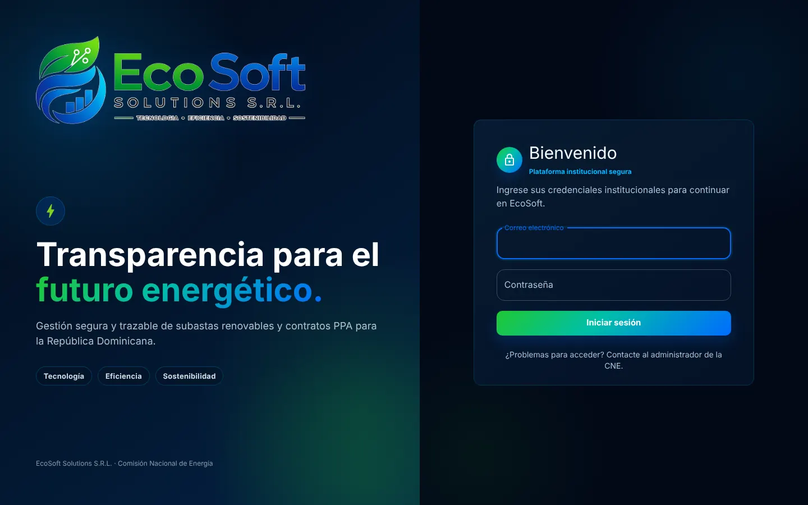                             | 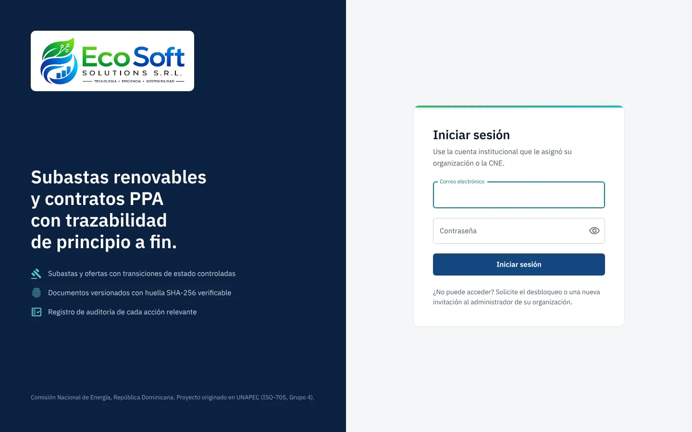                                         |
| Panel de control          | 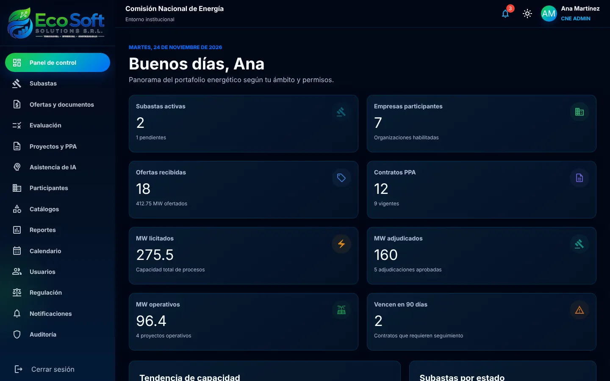                         | 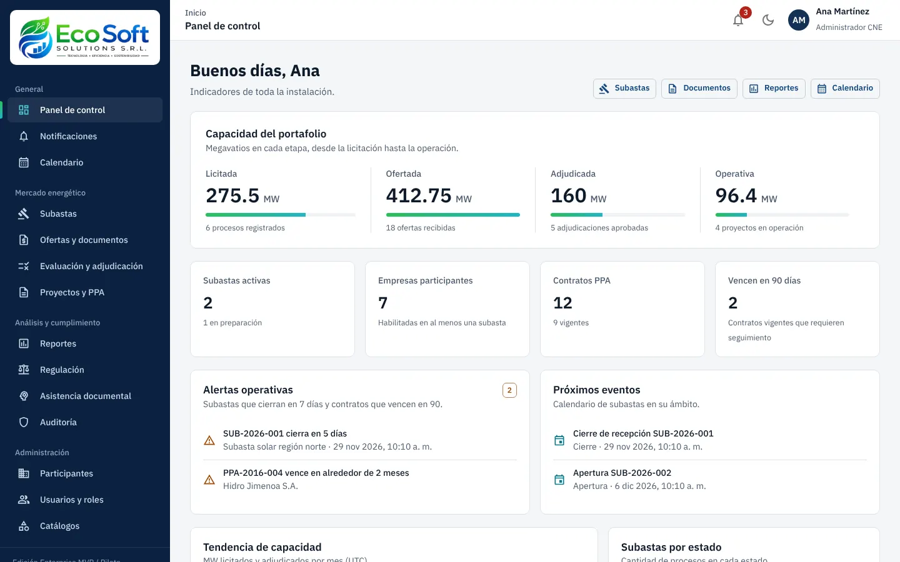 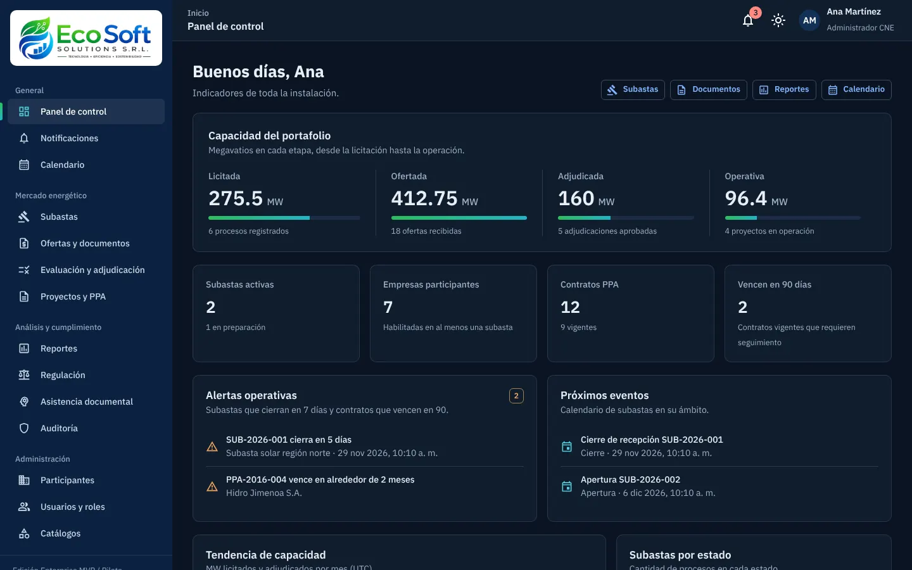 |
| Panel en móvil (390 px)   | —                                                             | 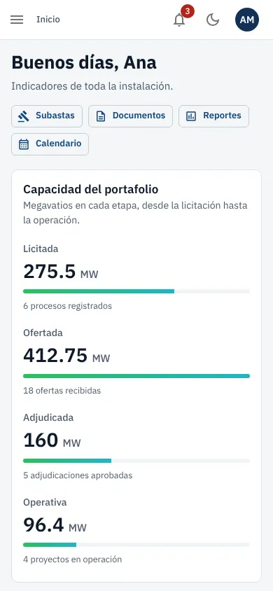 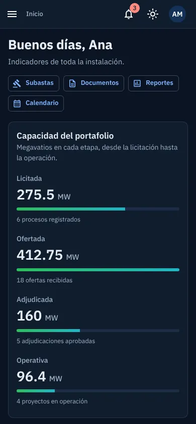   |
| Cancelación de subasta    | `window.prompt()` del navegador (no capturable)               | 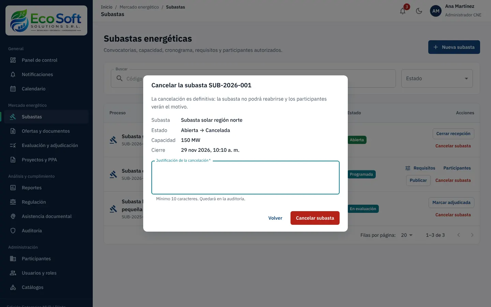                             |
| Ofertas en móvil (oscuro) | —                                                             | 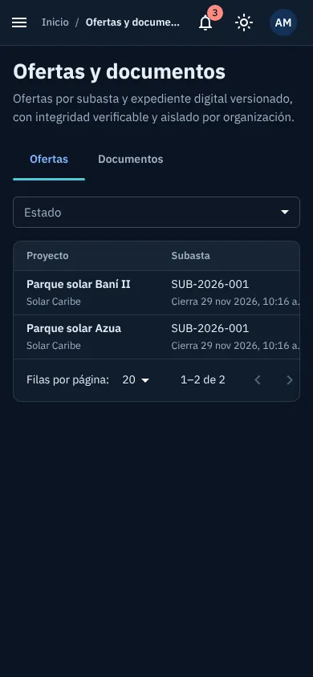                                         |
| Usuarios                  | 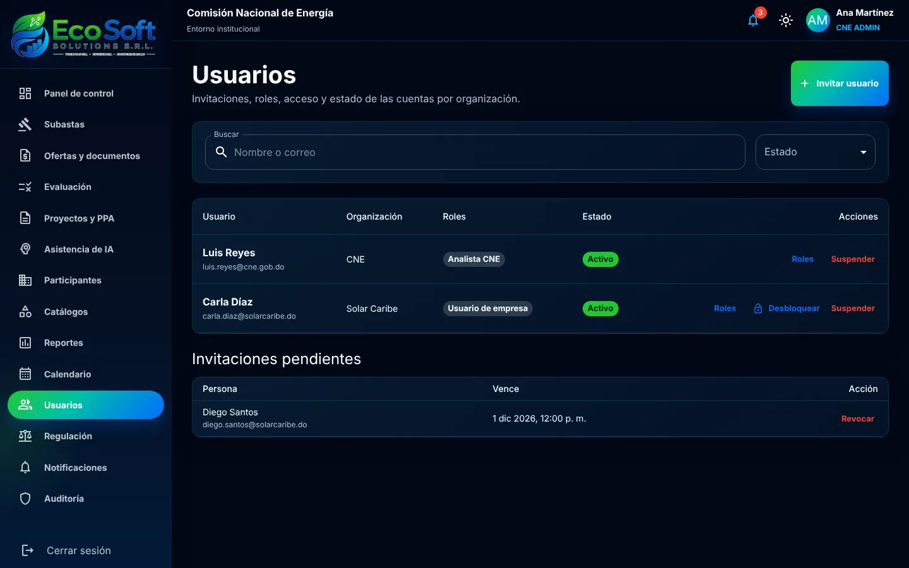 suspensión sin confirmar | 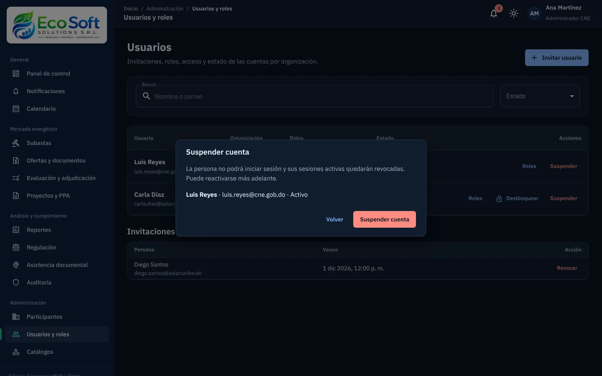                             |
| Asistencia documental     | 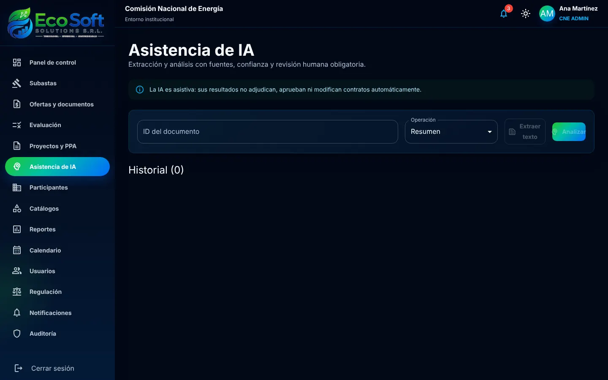 UUID manual, JSON crudo        | 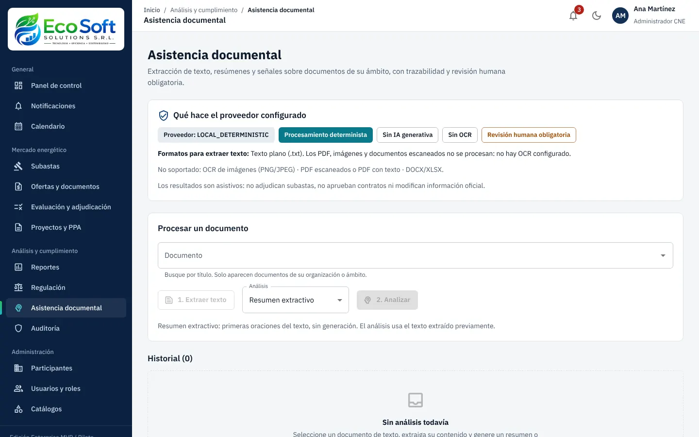 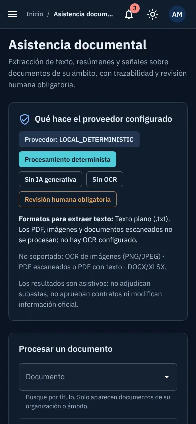                |

El `main` anterior arrancaba siempre en tema oscuro, sin considerar la preferencia del sistema
(se podía alternar manualmente); la versión nueva parte de la preferencia del sistema y también
permite alternarla.
